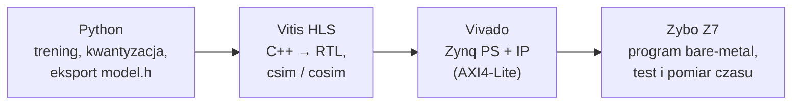

# Drzewo decyzyjne i las losowy w FPGA

Sprzętowy akcelerator klasyfikatora drzewiastego dla układu Zynq-7020, zaprojektowany
w Vitis HLS. Projekt realizowany w ramach przedmiotu **Programowanie wysokopoziomowe
układów (ESL)**, temat 14: *Drzewo decyzyjne i las losowy w sprzęcie*, rok akademicki 2026/2027.

---

## Spis treści

1. [Cel projektu](#cel-projektu)
2. [Model i dane](#model-i-dane)
3. [Zgodność bit w bit z modelem referencyjnym](#zgodność-bit-w-bit-z-modelem-referencyjnym)
4. [Architektura i warianty](#architektura-i-warianty)
5. [Wyniki](#wyniki)
6. [Struktura repozytorium](#struktura-repozytorium)
7. [Wymagania](#wymagania)
8. [Uruchomienie](#uruchomienie)
9. [Harmonogram i podział pracy](#harmonogram-i-podział-pracy)

---

## Cel projektu

Drzewo decyzyjne w każdym węźle porównuje jedną cechę z progiem. W sprzęcie oznacza to
wyłącznie komparatory: nie występują mnożenia (zerowe zużycie bloków DSP), a wszystkie
węzły mogą być obliczane jednocześnie. Celem projektu jest:

- implementacja wytrenowanego w scikit-learn drzewa decyzyjnego, a następnie lasu losowego,
  jako bloku IP w logice programowalnej,
- uzyskanie wyników **identycznych** z modelem referencyjnym w Pythonie,
- porównanie kolejnych wariantów architektury pod względem opóźnienia, przepustowości
  i zużycia zasobów (LUT, FF, BRAM, DSP),
- weryfikacja na płytce Digilent Zybo Z7 (Zynq-7000) i porównanie z implementacją
  programową na procesorze ARM.

## Model i dane

| parametr | wartość |
|---|---|
| zbiór danych | Breast Cancer Wisconsin (`sklearn.datasets`) |
| liczba cech / klas / próbek | 30 / 2 / 569 |
| podział | 70% uczący, 30% testowy (171 próbek), stratyfikowany, `random_state=42` |
| drzewo | `DecisionTreeClassifier(max_depth=5)`: 27 węzłów, 14 liści |
| las | `RandomForestClassifier(n_estimators=8, max_depth=5)` |
| reprezentacja cech | liczby całkowite bez znaku, 12 bitów (wariant v3: 8 bitów) |

Cechy są skalowane metodą min-max (zakres wyznaczony na zbiorze uczącym) i kwantyzowane
do liczb całkowitych. Tę samą operację wykonuje host przed przesłaniem próbki do układu.

## Zgodność bit w bit z modelem referencyjnym

Model jest trenowany **na cechach już skwantowanych**. scikit-learn wyznacza progi
w połowie odległości między sąsiednimi wartościami cechy, więc dla cech całkowitych
każdy próg ma postać `k + 0.5`. Dla całkowitego `x` zachodzi

```
x ≤ k + 0.5   ⇔   x ≤ k
```

Do sprzętu trafia zatem próg całkowity `k = ⌊t⌋`, a każde porównanie daje dokładnie ten sam
wynik co w scikit-learn. Zgodność wynika z konstrukcji, a nie z doboru danych testowych.

W lesie układ stosuje głosowanie większościowe (remis rozstrzygany na korzyść klasy o niższym
numerze), podczas gdy `RandomForestClassifier.predict` uśrednia prawdopodobieństwa.
Referencją dla lasu jest więc głosowanie większościowe liczone w Pythonie na drzewach
z scikit-learn. Zgodność z `predict` jest raportowana osobno (dla użytego modelu: 100%).

## Architektura i warianty



Wszystkie cechy próbki są przekazywane jako jedno spakowane słowo przez interfejs AXI4-Lite,
a wynikiem funkcji jest numer klasy. Kolejne warianty zgodnie z cyklem ulepszania wprowadzają
po jednej zmianie:

| wariant | plik | opis | oczekiwany efekt |
|---|---|---|---|
| **v0** | `dt_v0_seq.cpp` | drzewo zapisane w ROM (BRAM), jeden węzeł = jedno słowo 64-bitowe; przechodzenie węzeł po węźle | punkt odniesienia: kilka taktów na poziom drzewa, minimalne zużycie logiki |
| **v1** | `dt_v1_par.cpp` | komparator dla każdego węzła, wszystkie porównania jednocześnie; liść wybierany iloczynem porównań na ścieżce; potok `II=1` | opóźnienie kilku taktów, nowa próbka w każdym takcie, brak BRAM |
| **v2** | `rf_v2_forest.cpp` | las 8 drzew w architekturze v1 liczonych równolegle + głosowanie | zasoby rosnące liniowo z liczbą drzew przy niemal niezmienionym opóźnieniu |
| **v3** | `rf_v2_forest.cpp` + `gen/b8` | wariant v2 z cechami i progami 8-bitowymi zamiast 12-bitowych | mniejsze zużycie LUT przy zachowanej dokładności |

Zegar docelowy: 100 MHz, układ `xc7z020clg400-1` (Zybo Z7-20). Dla Zybo Z7-10 i starszego Zybo
(`xc7z010clg400-1`) skrypty przyjmują inną część (patrz [Uruchomienie](#uruchomienie)).

## Wyniki

### Dokładność (Python, zbiór testowy 171 próbek)

| model | float | 12 bit | 8 bit |
|---|---|---|---|
| drzewo, `max_depth=5` | 0.9298 | 0.9298 | 0.9240 |
| las, 8 × `max_depth=5` | 0.9298 | 0.9298 | 0.9298 |

Pełne zestawienie dokładności w zależności od szerokości cech (2–16 bitów) i głębokości
drzewa: [`results/sweep.md`](results/sweep.md).

### Weryfikacja funkcjonalna (symulacja C)

| wariant | próbki zgodne z Pythonem | dokładność |
|---|---|---|
| v0 | 171 / 171 | 0.9298 |
| v1 | 171 / 171 | 0.9298 |
| v2 | 171 / 171 | 0.9298 |
| v3 | 171 / 171 | 0.9298 |

### Synteza HLS

Wyniki syntezy (opóźnienie, II, LUT, FF, BRAM, DSP) są zbierane skryptem
`python/hls_report.py` do pliku `results/hls_results.md` i zostaną uzupełnione w kolejnym
etapie projektu.

## Struktura repozytorium

```
├── python/
│   ├── train_export.py     trening, kwantyzacja, eksport modelu i danych testowych do C++
│   └── hls_report.py       zestawienie wyników syntezy wszystkich wariantów
├── gen/
│   ├── b12/                model 12-bitowy: model.h, test_data.h, test_data.npz, summary.json
│   └── b8/                 model 8-bitowy (wariant v3)
├── hls/
│   ├── dt.h                typy wspólne (ap_uint) i deklaracje funkcji
│   ├── dt_v0_seq.cpp       wariant v0
│   ├── dt_v1_par.cpp       wariant v1
│   ├── rf_v2_forest.cpp    warianty v2 i v3
│   ├── tb.cpp              testbench (zgodność bit w bit z Pythonem)
│   ├── run_hls.tcl         csim, synteza, kosymulacja i eksport IP
│   └── run_csim.sh         symulacja C kompilatorem g++
├── vivado/
│   └── build_bd.tcl        projekt blokowy Zynq + IP, bitstream
├── zybo/
│   └── dt_host.c           program hosta bare-metal na Zybo (Vitis)
└── results/
    └── sweep.md            dokładność a szerokość cech i głębokość drzewa
```

Pliki w `gen/` są generowane przez `train_export.py` i dołączone do repozytorium, aby kod HLS
można było syntetyzować bez uruchamiania Pythona.

## Wymagania

- AMD Vivado i Vitis HLS (wersje 2020.2–2024.x; licencja bezpłatna obejmuje Zynq-7020)
- Python 3.8+ z pakietami `numpy` i `scikit-learn`
- płytka Digilent Zybo Z7-20 (lub Z7-10 / Zybo) oraz pliki płytek Digilent dla Vivado
  ([Digilent/vivado-boards](https://github.com/Digilent/vivado-boards): zawartość katalogu
  `new/board_files` należy skopiować do `<Vivado>/data/boards/board_files`)
- terminal szeregowy (np. PuTTY, Tera Term) do odczytu wyników z UART

## Uruchomienie

```bash
git clone https://github.com/Sirkorn707/esl-tree-project.git
cd esl-tree-project
```

### 1. Model (opcjonalnie, pliki w `gen/` są już wygenerowane)

```bash
pip install numpy scikit-learn
python3 python/train_export.py              # gen/b12
python3 python/train_export.py --bits 8     # gen/b8
python3 python/train_export.py --sweep      # results/sweep.md
```

Parametry: `--dataset`, `--depth`, `--trees`, `--forest-depth`, `--bits`, `--seed`.

### 2. Vitis HLS

```bash
cd hls
vitis_hls -f run_hls.tcl                    # Vitis HLS 2020.2–2023.2
vitis-run --mode hls --tcl run_hls.tcl      # Vitis 2024.1 i nowsze
```

Zmienne środowiskowe: `VARIANTS="v0 v1"` ogranicza listę wariantów, `COSIM=0` pomija
kosymulację, `PART=xc7z010clg400-1` wybiera układ Zybo Z7-10 / Zybo. Po syntezie:

```bash
cd .. && python3 python/hls_report.py       # results/hls_results.md
```

Konfiguracja w GUI: funkcja główna `dt_v0`, `dt_v1` lub `rf_v2`; w polu CFLAGS pliku źródłowego
i testbencha `-I<repo>/gen/b12` (dla v3: `gen/b8`); testbench dodatkowo
`-DVARIANT=0|1|2`; część `xc7z020clg400-1`, okres zegara 10 ns.

Szybka symulacja C bez Vitis (wymaga nagłówków `ap_int.h`):

```bash
AP_INCLUDE=<ścieżka>/Vitis_HLS/<wersja>/include hls/run_csim.sh
```

### 3. Vivado

```bash
cd vivado
vivado -mode batch -source build_bd.tcl -tclargs v1                # Zybo Z7-20
vivado -mode batch -source build_bd.tcl -tclargs v1 zybo-z7-10     # Zybo Z7-10
```

Skrypt tworzy projekt blokowy (Zynq PS z ustawieniami płytki + IP z HLS na `M_AXI_GP0`),
generuje bitstream i zapisuje platformę sprzętową `vivado/out/dt_v1.xsa` (z bitstreamem)
oraz raporty zasobów i taktowania po implementacji. Równoważnie w GUI: projekt z płytką Zybo →
ZYNQ7 Processing System → Run Block Automation → dodanie IP z HLS → Run Connection Automation →
Create HDL Wrapper → Generate Bitstream → File › Export › Export Hardware (Include bitstream).

### 4. Program na Zybo (Vitis, bare-metal)

1. W Vitis utworzyć platformę z pliku `dt_v1.xsa` (system operacyjny *standalone*,
   procesor `ps7_cortexa9_0`) i zbudować ją.
2. Utworzyć aplikację z szablonu *Empty Application (C)* dla tej platformy.
3. Do katalogu `src` aplikacji skopiować `zybo/dt_host.c` oraz `gen/b12/model.h`
   i `gen/b12/test_data.h` (dla v3: pliki z `gen/b8`).
4. Ustawić wariant w `dt_host.c` (`DT_VARIANT`: 0, 1 lub 2 dla v2/v3) i zbudować aplikację.
5. Podłączyć płytkę przez micro-USB (zworka bootowania w pozycji JTAG), otworzyć terminal
   szeregowy 115200 8N1 i uruchomić aplikację (Run As › Launch Hardware). Vitis wgrywa
   bitstream i program.

   W Vitis 2023.2 i nowszych (nowe IDE) odpowiednikami są *Platform Component*
   i *Application Component*, a aplikację uruchamia się przyciskiem *Run*.

Przykładowy wynik:

```
=== ESL temat 14: wariant 1, cechy 12-bitowe, 171 probek ===
Niezgodnosci HW vs Python: 0
Dokladnosc HW: 159/171 (92.9%)
Czas na probke: HW (z transferem AXI-Lite) ... ns, SW drzewo na ARM ... ns
TEST OK
```

Adres bazowy IP jest odczytywany z `xparameters.h`, a przesunięcia rejestrów z nagłówka
sterownika wygenerowanego przez HLS (`x<funkcja>_hw.h`); w razie ich braku program używa
wartości domyślnych (`0x43C00000`, `ap_return` = `0x10`, argument = `0x18`).

## Harmonogram i podział pracy

| etap | zakres | status |
|---|---|---|
| 1 | model, eksport do C++, testbench, symulacja C | zakończony |
| 2 | v0 i v1: synteza i kosymulacja | w toku |
| 3 | v2 i v3, zestawienie taktów i zasobów | planowany |
| 4 | implementacja w Vivado, pomiary na płytce | planowany |
| 5 | sprawozdanie | planowany |

| osoba | zakres |
|---|---|
| KO | model i weryfikacja: trening i eksport, testbench, analiza dokładności, program hosta i pomiary na płytce |
| RM | sprzęt: jądra HLS, dyrektywy, synteza i kosymulacja, projekt w Vivado, analiza zasobów |
